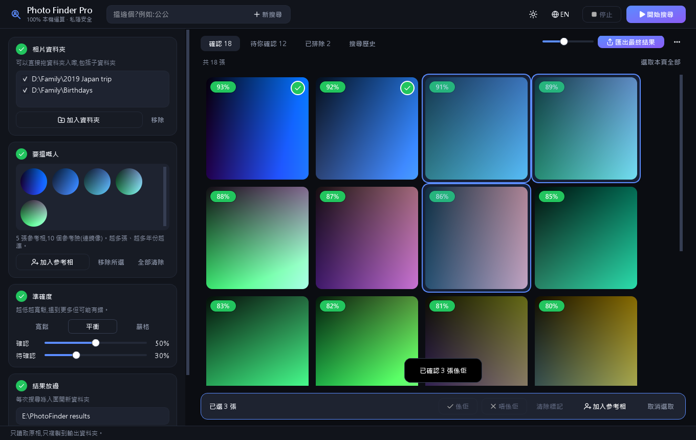
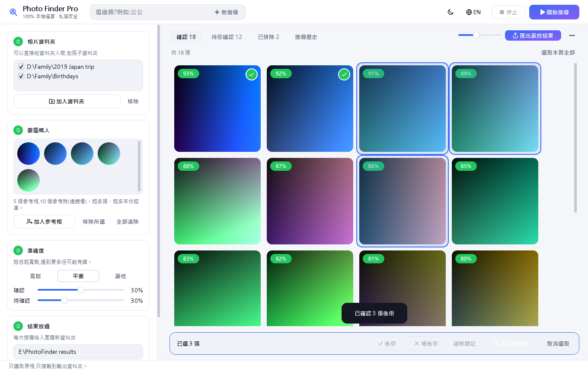
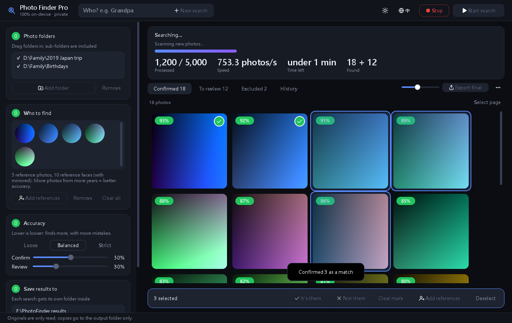

<p align="center"></p>

<h1 align="center">Photo Finder Pro</h1>

<p align="center">
在您的照片文件夹中找出某个人的全部照片,人脸比对完全在您自己的电脑上运行。<br>
原始照片只会被读取。匹配的照片会被<b>复制</b>到结果文件夹,不会被移动、删除或上传。
</p>

<p align="center"><b><a href="../../releases/latest">⬇ 下载 Windows 版</a></b> · <a href="README.md">English</a> · 简体中文 · 免费开源(MIT)</p>



## 功能介绍

提供某个人的几张参考照片(例如外公不同年龄的照片),再选择一个或多个照片文件夹。程序会检查每一张照片(包括子文件夹),找出此人出现的照片。

- **本地运行,保护隐私。** 人脸检测(YuNet)和识别(SFace)在您的 CPU 上离线运行。程序不联网,也不发送任何遥测数据。
- **安全设计。** 原始照片以只读方式打开。每个副本都会用 SHA-256 校验,已有文件不会被覆盖。每次搜索都有独立的结果文件夹。
- **实时且快速。** 照片由多个 CPU 线程并行分析,扫描过程中就能看到匹配结果,并显示进度、速度和剩余时间。可随时停止,稍后继续。
- **快速复核。** 双击一张结果(或按 **Enter**),再按 **Y** 表示“是此人”、按 **N** 表示“不是此人”,随即跳到下一张。在网格中,**Ctrl+A** 全选本页,**Y / N / U** 用于标记或清除所选照片的标记。标记只是标签,不会删除任何文件。
- **按相似度或拍摄日期排序。** 日期取自照片的 EXIF 信息,没有则使用文件日期,并缓存在程序自己的索引中。
- **导出最终结果。** 一键把复核后的照片复制到本次搜索结果文件夹下的 `final\`。
- **越用越准。** 可把好的结果加回为参考照片来提升匹配效果。一张照片中有多个人时,可以选择正确的那张脸。
- **使用舒适。**
  - 深色与浅色主题。界面为简体中文或英文,安装向导会按系统语言显示。
  - 可把文件夹和照片直接拖入窗口。
  - 可缩放、以人脸为中心的缩略图。
  - 准确度预设:宽松、平衡、严格。
  - 支持 HEIC(iPhone)照片。
  - 记住窗口大小和位置。⋯ 菜单中有“关于”对话框和“检查更新”链接(仅在浏览器中打开 GitHub 发布页)。

| 浅色主题 | 扫描中(英文界面) |
|---|---|
|  |  |

*截图使用的是生成的彩色图片,不是真实照片。*

## 下载与安装(Windows 10/11)

请到 [Releases](../../releases/latest) 页面下载。所有文件均为 64 位(x64),共三个,任选其一:

- **安装版(推荐):** `PhotoFinderPro-<版本>-x64-Setup.exe`。双击后按向导操作,仅为当前用户安装,无需管理员权限。会创建开始菜单项(可选桌面快捷方式),可在 Windows **设置 → 应用** 中卸载,也可使用开始菜单里的卸载快捷方式。
- **便携版:** `PhotoFinderPro-<版本>-x64-Portable.exe`。单个文件,放在任意位置双击即可,不会安装任何内容。首次启动需要几秒钟解压。
- **压缩包:** `PhotoFinderPro-<版本>-x64.zip`。解压到任意位置,运行 `PhotoFinderPro.exe`。不会安装任何内容,启动速度比单文件便携版更快。

`SHA256SUMS.txt` 列出了每个文件的 SHA-256 校验值,可用于核对下载的文件。

### 如何确认下载的文件可信

1. 只从本仓库的 **Releases** 页面下载,不要使用镜像站或他人发来的链接。
2. 同时下载同一个发布页中的 `SHA256SUMS.txt`。
3. 在下载目录中打开 PowerShell,运行下面的命令(文件名换成您实际下载的文件):

   ```powershell
   Get-FileHash .\PhotoFinderPro-1.0.1-x64-Setup.exe -Algorithm SHA256
   ```

4. 将输出的 `Hash` 与 `SHA256SUMS.txt` 中对应文件的那一行比较(不区分大小写)。完全一致,说明文件完整且就是这里发布的版本;不一致,请删除后重新下载。

本仓库中的源代码就是程序的完整源代码,且程序不联网,您可以自行查看。

由于程序没有代码签名,首次运行时 Windows SmartScreen 可能会弹出警告,请点击 **更多信息 → 仍要运行**。

无论哪种方式,设置、扫描索引和缩略图都保存在 `%LOCALAPPDATA%\PhotoFinderPro`。卸载安装版时,程序会询问是否一并删除这些数据,默认保留;您的照片和导出的结果始终不受影响。

## 使用方法

1. **照片文件夹。** 添加或拖入要搜索的文件夹,子文件夹会一并包含。
2. **要查找的人。** 添加几张清晰的参考照片。来自不同年份的照片越多,结果越好。
3. **准确度。** 建议先选“平衡”。得分达到 *确认*(50%)的照片视为匹配;介于 *待确认*(30%)与 *确认* 之间的照片会进入“待确认”。
4. **结果保存到。** 选择输出文件夹,它不能位于照片文件夹之内。
5. 点击 **开始搜索**。然后在“待确认”页用 Y / N 复核,最后点击 **导出最终结果**。

## 从源代码运行

需要 Windows 上的 Python 3.12 或更高版本。

```bat
python -m venv venv
venv\Scripts\pip install -r requirements.txt
run_photofinderpro.bat
```

运行测试(使用合成图片和模拟的人脸引擎,不涉及真实照片):

```bat
venv\Scripts\python -m pytest -q -p no:cacheprovider tests
```

构建发布文件(单目录构建、自检、压缩包、单文件构建、自检、安装包、校验值)。安装包这一步需要 [Inno Setup 6](https://jrsoftware.org/isinfo.php)(`winget install --id JRSoftware.InnoSetup -e`):

```bat
cmd /c packaging\build.bat
```

输出文件:`dist\PhotoFinderPro-1.0.1-x64-Setup.exe`、`dist\PhotoFinderPro-1.0.1-x64-Portable.exe`、`dist\PhotoFinderPro-1.0.1-x64.zip` 和 `dist\SHA256SUMS.txt`。

## 局限

- 准确度尚未在真实人脸基准上测量过。人脸较小、侧脸角度大或年龄跨度很大时,准确度会下降。
- 目前仅支持 Windows。
- 这是个人项目,不是商业产品。SFace 模型权重使用公开人脸数据集训练,其条款可能限制商业用途。请只搜索您拥有或获准使用的照片。

本项目采用 [MIT 许可](LICENSE)。第三方许可见 [THIRD_PARTY_NOTICES.txt](THIRD_PARTY_NOTICES.txt),隐私政策见 [PRIVACY.md](PRIVACY.md)。
